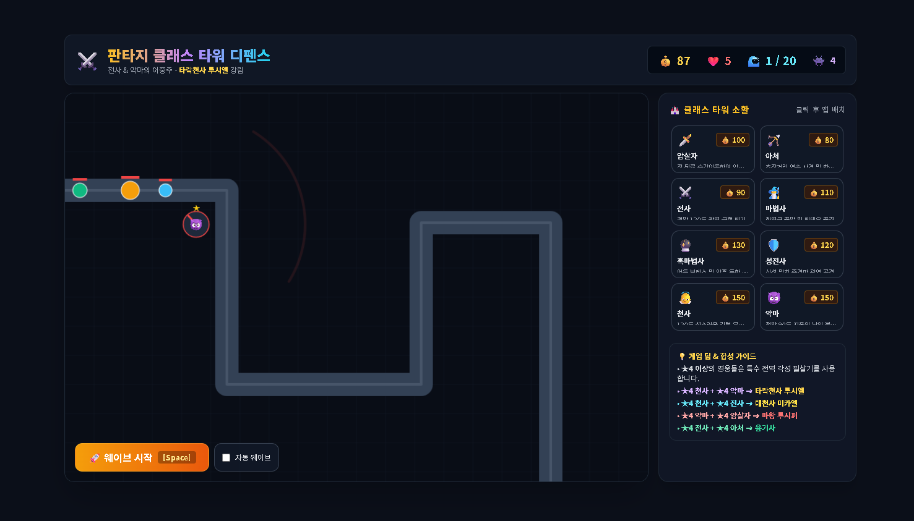

# 📝 게임 기획서

### 3주차 · 보완한 기획서

`WEEK 03` · `기획서 피드백 및 구체화` · `성과물: 보완한 게임 기획서`

2주차 기획서를 Gemini 점검과 튜팅 피드백으로 보완해서 다시 정리합니다. 위쪽 **🤖 Gemini와 기획서 보완하기**를 이용하면 Gemini와 정리한 내용을 이 양식에 바로 채울 수 있어요.

> ✏️ **작성 방법:** 오른쪽 위 연필 ✏️ 아이콘을 누르고 빈칸에 내용을 적은 다음 **Commit changes**를 누르세요.

---

## 1️⃣ 이 게임을 한 문장으로 소개하기

> 예: 고양이가 떨어지는 생선을 받고 폭탄은 피하며 최대한 오래 버티는 게임

**답:** 길을 따라 몰려오는 적을 타워를 설치해서 막는 게임

## 2️⃣ 타깃 플레이어

> 이 게임을 누가 할지 적습니다. 아직 못 정했으면 빈칸으로 둡니다.

**답:** 12세 ~25세

## 3️⃣ 레퍼런스 게임 (2~3개)

| 🎮 게임 이름 | 🏷️ 장르 | 👀 참고하고 싶은 점 |
|---|---|---|
| 명일방주 | 타워디펜스 | 캐릭터 디자인,캐릭터를 얻는 방식 |
| 운빨존많겜 | 타워디펜스 | 게임 난이도 |
| 킹덤 러시 | 타워디펜스 |  |

## 4️⃣ 핵심 요소

> 이 게임에서 가장 중요한 재미 요소는 무엇인가요?

**답:** 캐릭터를 얻으면서 어려움 난이도의 맵 클리어

---

## 5️⃣ 스테이지 1 만들어 보기

> 📌 게임 전체가 아니라 **첫 번째 스테이지 하나만** 생각합니다. 스테이지 1을 만들려면 무엇이 필요한지 적어 봅니다.

### 5-1. 스테이지 1에서 일어나는 일

| 구분 | 내 게임에서는 |
|---|---|
| ▶️ **시작할 때** | 시작할까요 라는 문구가 뜬다 |
| 🔄 **플레이 중** | 몬스터가 몰려온다 |
| 🏆 **클리어 조건** | 타워를 설치해서 막는다 |
| 💥 **실패 조건** | 몬스터가 기지를 들어온다 |

### 5-2. 스테이지 1에 등장하는 것들

게임 프로그램은 등장하는 것마다 **갖고 있는 정보**와 **하는 행동**으로 이루어집니다. 아래 표가 나중에 내 프로그램의 구조가 됩니다.

| 이름 | 갖고 있는 정보 (예: 위치, 목숨) | 하는 행동 또는 규칙 (예: 이동, 점프) |
|---|---|---|
| 🧍 **플레이어** | 설치,판매,업그레이드 | 타워를 설치해서 몬스터를 막는다 |
| 기지 | 체력 | 체력이 0이 돼면 게임이 끝남 |
| 타워 | 범위,공격속도,공격력 | 자신이 가진 스펙으로 몬스터를 막는다 |
| 몬스터 | 체력,이동속도 | 기지로 간다 |

> 플레이어 외에 몬스터, 퍼즐, 아이템, 장애물 등 스테이지 1에 꼭 필요한 것만 적습니다. 부족하면 같은 모양으로 줄을 더 추가해도 돼요.

### 5-3. 입력 방식

> 사용할 입력 방식의 `[ ]`를 `[x]`로 바꾸고, 어떤 입력이 어떤 동작이 되는지 적습니다.

- [ ] ⌨️ 키보드
- [x] 🖱️ 마우스

| 입력 | 게임 속 동작 |
|---|---|
| 예: 스페이스 키 | 점프 |
| 왼쪽클릭 | 타워 선택 밑 업그래드 설치 |
| 오른쪽 클릭 | 타워 정보 |
|  |  |

### 5-4. 화면 시점

> 탑다운 / 사이드뷰 / 세로 스크롤 / 고정 한 화면 / 쿼터뷰 / 3D 중 하나와 이유를 적습니다.

**답:** 고정 한 화면 | 스테이지 1을 처음 만들 때는 화면이 여러 개로 스크롤되면

---

## 7️⃣ 스테이지 1 화면 그림

> 그림판이나 종이에 그린 스테이지 1 화면과, 그 그림으로 Gemini에게 받은 목업을 올립니다.

**✏️ 내 손그림**

_(내 손그림을 아직 올리지 않았어요)_

**🖼️ Gemini 목업**

---

🛠️ 4주차에는 이 기획서로 구성요소를 하나씩 만들어요!

